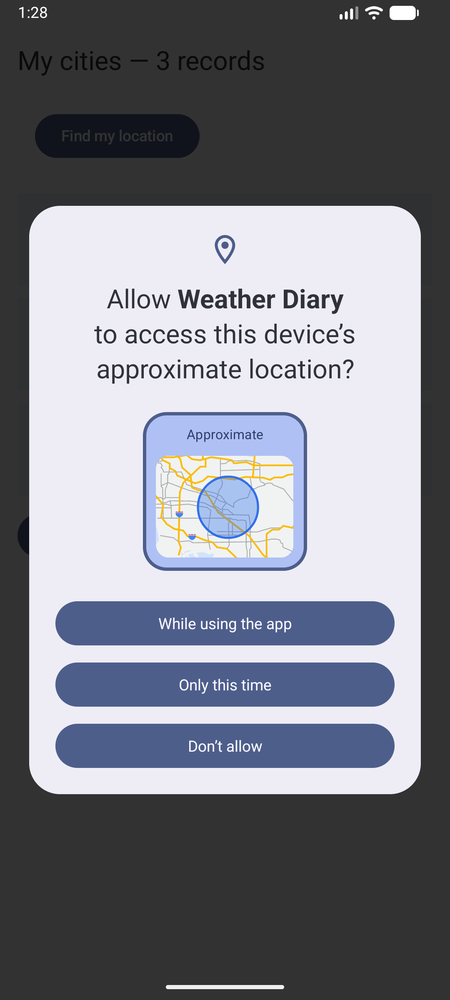
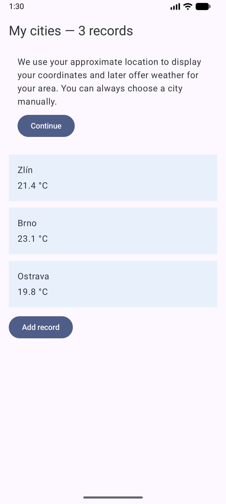
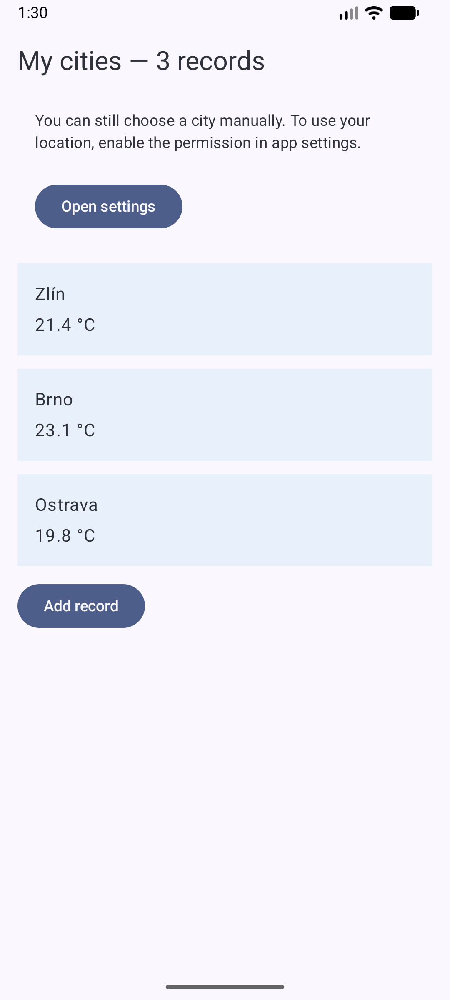
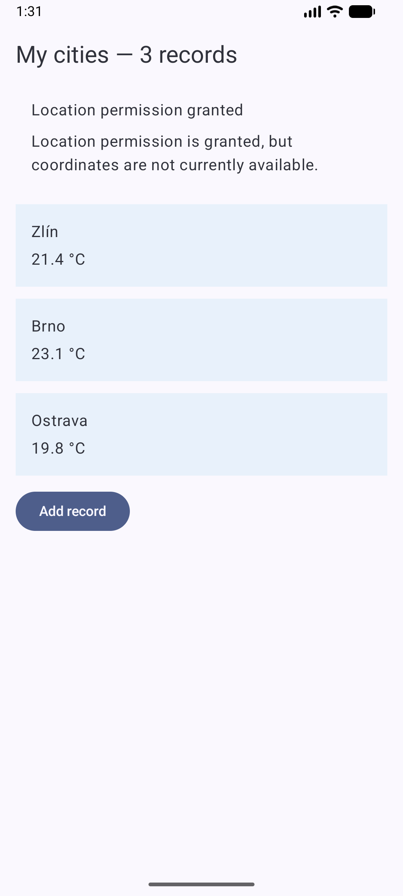

# Lekce 06 – Žádost o oprávnění k poloze

## Testování oprávnění

| Stav | Jak jsem ho vyvolal | Výsledek |
|---|---|---|
| NEZNAMY | První spuštění aplikace a kliknutí na Zjistit moji polohu | Zobrazil se systémový dialog s žádostí o povolení polohy. |
| ODMITNUTO | První zamítnutí oprávnění a další kliknutí na tlačítko | Aplikace nejprve zobrazila vlastní vysvětlení, proč polohu potřebuje. |
| ODMITNUTO_NATRVALO | Druhé zamítnutí oprávnění | Aplikace zobrazila informaci o nepovolené poloze a tlačítko pro otevření Nastavení. |
| UDELENO | Povolení polohy v Nastavení a návrat do aplikace | Aplikace zobrazila informaci o povolené poloze a dostupné souřadnice, případně upozornění na jejich nedostupnost. |

## Proč používáme ACCESS_COARSE_LOCATION?

Používáme ACCESS_COARSE_LOCATION, protože pro zjištění přibližné oblasti a města nepotřebujeme přesnou polohu uživatele.

ACCESS_COARSE_LOCATION poskytuje přibližnou polohu, zatímco ACCESS_FINE_LOCATION umožňuje určit polohu s vyšší přesností, například pro navigaci.

Pro naši aplikaci stačí přibližná poloha, protože chceme nabídnout počasí pro okolí uživatele, ne určovat jeho přesnou adresu.

## Ošetření chyb

Před čtením polohy kontrolujeme, jestli má aplikace udělené oprávnění.

Používáme také try/catch pro SecurityException, aby aplikace nespadla při problému s oprávněním.

Pokud getLastKnownLocation vrátí null, zobrazíme text, že souřadnice nejsou momentálně dostupné.

## Screenshoty

### 1. NEZNAMY

### 2. ODMITNUTO

### 3. ODMITNUTO_NATRVALO

### 4. UDELENO

